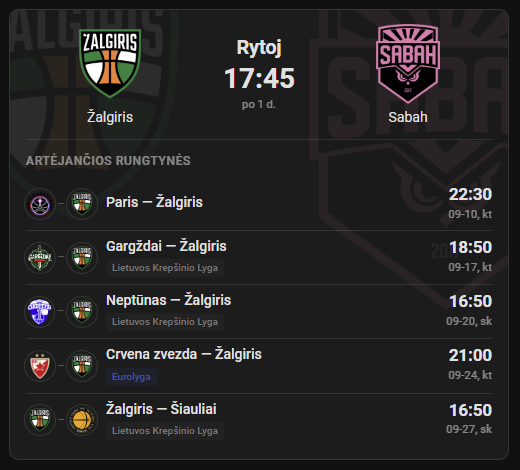

# Žalgiris Card

Home Assistant „Lovelace“ korta, skirta [Žalgiris Matches](https://github.com/braticks/zalgiris_matches) integracijai.

Rodo artimiausias rungtynes, varžovų logotipus, turnyrą, transliuotoją, rungtynių pradžios laiką, tiesioginį rezultatą ir artėjančių rungtynių sąrašą.



## Vizualus redaktorius (2.0.4)

Dashboard → Redaguoti → kortos „Redaguoti“. Formoje galite pasirinkti sensorių (paieška pagal entity ID), rungtynių skaičių, vieną ar kelias lygas, namų / išvykos filtrą, datos / laiko akcentą ir rodymo jungiklius. Spauskite **Išsaugoti** — parinktys išliks kortos konfigūracijoje ir perkrovus puslapį. YAML tebėra palaikomas.

Jei forma nerodoma, atnaujinkite kortą per HACS ir perkraukite naršyklę išvalydami podėlį. Redaktoriaus parinktys išsaugomos HA; pačios kortos filtrų mygtukai tebėra laikini.

English: the visual card editor supports the sensor, game count, multiple leagues, venue, date/time emphasis and display toggles. Save through Home Assistant to persist settings. YAML and existing extra configuration fields remain supported.

## Filtrai ir datos akcentas (2.0.3)

Pasiūlymas: [juzis28, issue #1](https://github.com/braticks/zalgiris-card/issues/1).

```yaml
type: custom:zalgiris-card
entity: sensor.zalgiris_rungtyniu_sarasas
count: 5
league: eurolyga
venue: home
show_filters: true
accent: date
```

| Parinktis | Numatyta | Galimos reikšmės |
| --- | --- | --- |
| `league` | `all` | `all`, `eurolyga`, `lkl`, `kmt` arba sąrašas, pvz. `[eurolyga, lkl]` |
| `venue` | `all` | `all`, `home`, `away` |
| `show_filters` | `false` | Rodyti lygos ir namų / išvykos mygtukus |
| `accent` | `time` | `date` išryškina datą; `time` išlaiko esamą vaizdą |

Lygos ir vietos filtrai veikia kartu, pagrindinėms rungtynėms ir sąrašui. `all` apima ir draugiškas ar nežinomos lygos rungtynes. Kelios lygos pasirenkamos YAML sąrašu; paspaudus lygos mygtuką pasirenkama viena lyga. Mygtukų pasirinkimai galioja tik tai kortai iki jos perkūrimo ar puslapio perkrovimo; tada vėl taikomas YAML. Nustatymai nesaugomi naršyklėje ir nesimaišo tarp kortų.

Integracijos keisti nereikia, papildomų užklausų serveriui filtrai nesiunčia. `accent` keičia būsimos dvikovos ir sąrašo datos / laiko išdėstymą; rezultatų rodymas lieka toks pats.

English: optional league and home/away filters apply to both the main game and schedule. Filter buttons are off by default; `accent: time` preserves the existing appearance. Button selections are local to each card instance and reset to YAML on reload.

## Būtina integracija

Kortos versija: **2.0.4**. Rekomenduojama integracija: **2.0.6** arba naujesnė.

Rezultatai atnaujinami integracijos nustatytu intervalu (numatyta 10 min.), ne nuolatiniu srautu. Be patvirtinto `is_live` lauko korta pirmas 3 valandas rodo „Prasidėjo pagal tvarkaraštį“, o vėliau „Praėjusios rungtynės“ — tai nėra patvirtinta rungtynių būsena. Transliuotojas ir rezultatas matomi tik gavus šiuos duomenis iš integracijos.

Pirmiausia įdiekite ir sukonfigūruokite [Žalgiris Matches](https://github.com/braticks/zalgiris_matches). Kortai reikalingas integracijos rungtynių sąrašo sensorius.

## Diegimas per HACS

1. HACS atidarykite `Custom repositories`.
2. Pridėkite `https://github.com/braticks/zalgiris-card`.
3. Pasirinkite kategoriją `Dashboard`.
4. Įdiekite `Žalgiris Card`.
5. Jei korta neatsirado iš karto, perkraukite naršyklę išvalydami podėlį.

## Rankinis diegimas

1. Atsisiųskite `zalgiris-card.js` į `/config/www/`.
2. Dashboard ištekliuose pridėkite `/local/zalgiris-card.js` kaip `JavaScript Module`.

## Naudojimas

```yaml
type: custom:zalgiris-card
entity: sensor.zalgiris_rungtyniu_sarasas
count: 5
show_league: true
```

Jeigu jūsų sensoriaus `entity_id` skiriasi, pakeiskite jį kortos konfigūracijoje.

| Parinktis | Būtina | Numatyta reikšmė | Aprašymas |
| --- | --- | --- | --- |
| `entity` | Taip | – | „Žalgiris Matches“ rungtynių sąrašo sensorius |
| `count` | Ne | `5` | Kiek artėjančių rungtynių rodyti (1–20) |
| `show_league` | Ne | `true` | Ar virš pagrindinių rungtynių rodyti turnyrą |

## English

Home Assistant Lovelace card for the [Žalgiris Matches](https://github.com/braticks/zalgiris_matches) integration. It displays the next game, team logos, competition, broadcaster, kickoff time, live score and upcoming games.

Install this repository through HACS as a `Dashboard` custom repository, then use:

```yaml
type: custom:zalgiris-card
entity: sensor.zalgiris_rungtyniu_sarasas
count: 5
show_league: true
```

Replace the entity ID if Home Assistant generated a different one.

## Problemos ir pasiūlymai

Praneškite apie klaidas per [GitHub Issues](https://github.com/braticks/zalgiris-card/issues).
