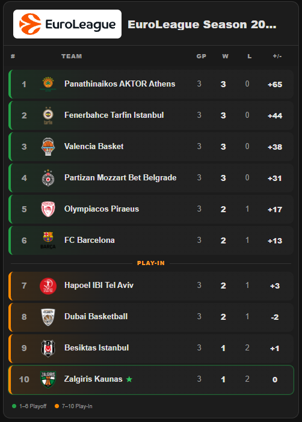

> **Šio paketo diegimas:** žr. [bendrą instrukciją](../../README.md). Toliau pateikta originali kortos ar integracijos dokumentacija; jos atskiros kortos diegimo instrukcijos bendram paketui netaikomos.

# EuroLeague Standings for Home Assistant

[](https://my.home-assistant.io/redirect/hacs_repository/?owner=braticks&repository=euroleague-standings&category=integration)

One HACS integration for EuroLeague standings **and** the Lovelace card.

## Preview



## Features

- Automatic current EuroLeague season detection
- Automatic current regular-season round detection
- Automatic fallback to the latest published standings round when the newest scheduled round is not available yet
- Standings from the EuroLeague public API
- Team logos from EuroLeague club data
- Points for, points against and point differential calculated from played regular-season games
- Persistent last-known standings cache that survives Home Assistant restarts
- Cached standings remain visible during temporary EuroLeague API failures
- Supplemental clubs / games API failures do not take the main standings offline
- Endpoint-specific warning logs for easier API troubleshooting
- Sensor: `sensor.euroleague_standings`
- Bundled `custom:euroleague-standings-card`
- Automatic Lovelace resource registration in storage mode
- Visual card editor in English
- Configurable TOP N, favorite team, Playoff / Play-In zones, team-logo mode, header mode, GP and +/- columns
- Three card density modes: **Normal**, **Compact** and **Super compact**
- HACS compatible

## Installation with HACS

Use the **Open in HACS** button above for one-click setup.

Manual fallback:

1. HACS → Integrations → three dots → Custom repositories.
2. Add `https://github.com/braticks/euroleague-standings` as **Integration**.
3. Install **EuroLeague Standings**.
4. Restart Home Assistant.
5. Settings → Devices & services → Add integration → **EuroLeague Standings**.
6. Add **EuroLeague Standings Card** from the dashboard card picker.

No separate HACS Dashboard repository is required from version 1.2.0 onward.

If the old `euroleague-standings-card` Dashboard repository was previously installed, update this integration first, restart Home Assistant, verify the card works, then the separate Dashboard repository can be removed from HACS.

### Manual YAML example

```yaml
type: custom:euroleague-standings-card
entity: sensor.euroleague_standings
count: 10
favorite_team: ZAL
always_show_favorite: true
team_logo_mode: background
header_style: logo
show_round: true
show_gp: false
show_diff: true
show_zones: true
density: super_compact
highlight_favorite: true
```

`density` accepts `normal`, `compact` or `super_compact`. Super compact mode uses smaller rows, logos and text, and hides the GP column, zone divider labels and legend to minimize card height.

Legacy configurations using `compact: true` are automatically treated as `density: compact`.

## Reliability and cached data

The integration stores the latest usable standings in Home Assistant storage.

If the EuroLeague API already lists a new regular-season round but its standings endpoint still returns HTTP 404, the integration automatically tries earlier rounds and uses the newest round with published standings. For example, if Round 4 is scheduled but its standings are not published yet, Round 3 remains available until Round 4 appears.

If the EuroLeague API is temporarily unavailable, the previous standings remain available instead of the sensor immediately becoming `unavailable`. This also works after a Home Assistant restart once at least one successful update has been cached.

Useful sensor attributes:

- `scheduled_round` — the newest regular-season round selected from the EuroLeague rounds feed.
- `round_fallback: true` — an earlier published standings round is currently being used because the newest scheduled round is not available yet.
- `data_stale: true` — the integration is currently showing cached standings because the required API data could not be refreshed.
- `partial_data: true` — the main standings are fresh, but supplemental clubs or games data failed to refresh.
- `partial_errors` — shows which supplemental request failed.
- `last_error` — contains the most recent full-update error while cached standings are being used.

## Lovelace YAML resource mode

The integration registers the card automatically when Lovelace resources use storage mode. If resources are managed in YAML, add this module manually:

```yaml
url: /euroleague_standings/euroleague-standings-card.js
resource_type: module
```

## Sensor data

The `teams` attribute contains position, team code, name, logo, games played, wins, losses, `points_for`, `points_against` and `points_diff`.

## Data source

This project uses public EuroLeague API endpoints and is not affiliated with EuroLeague Basketball.

EuroLeague name and logo are trademarks of their respective owner.
